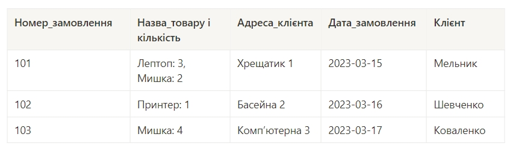
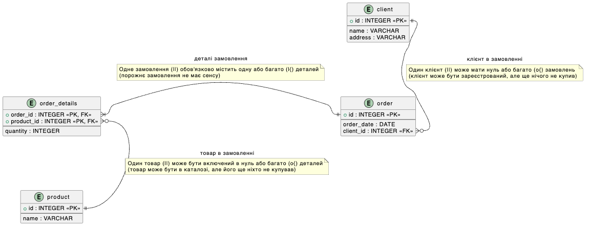
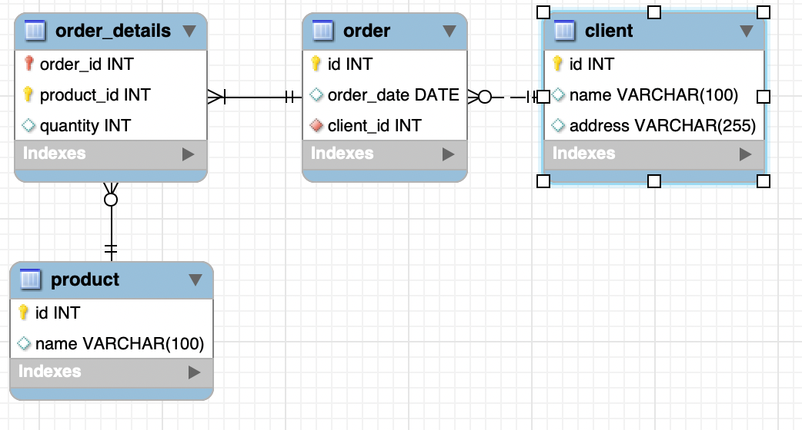
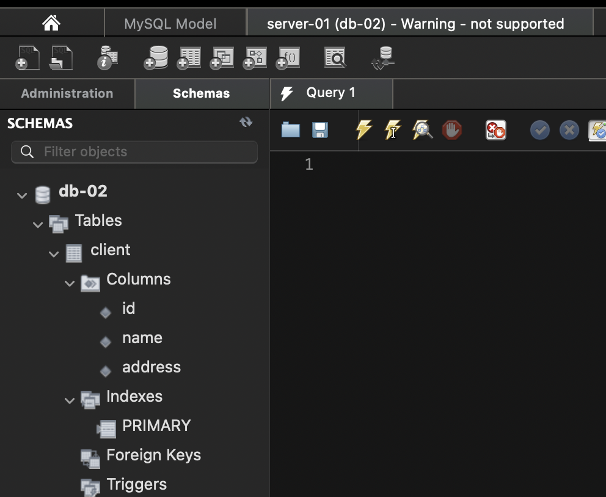
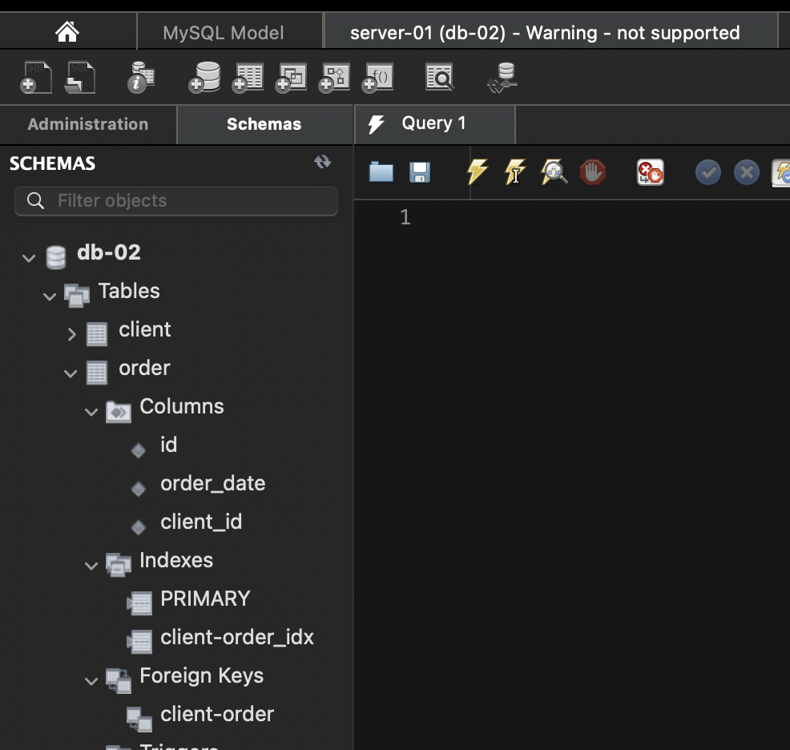
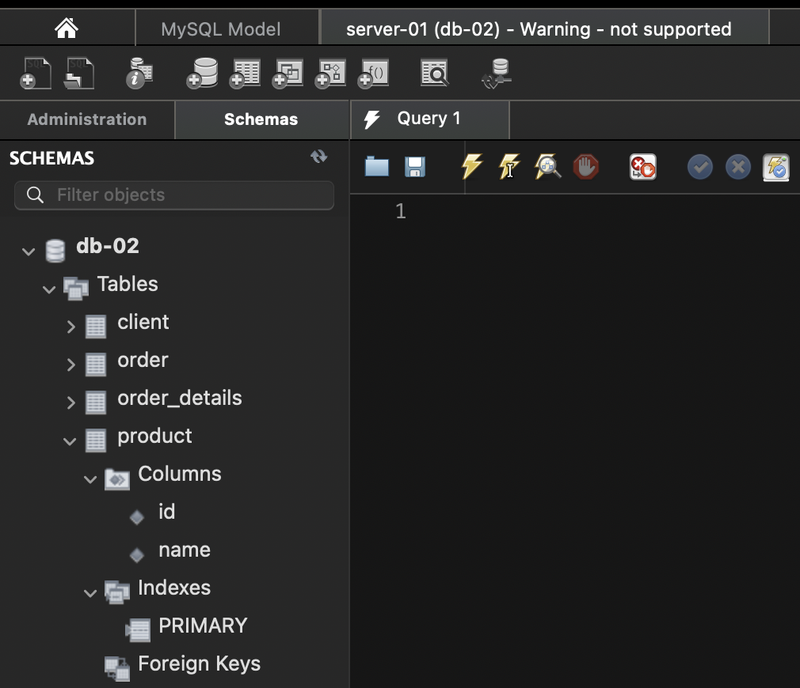
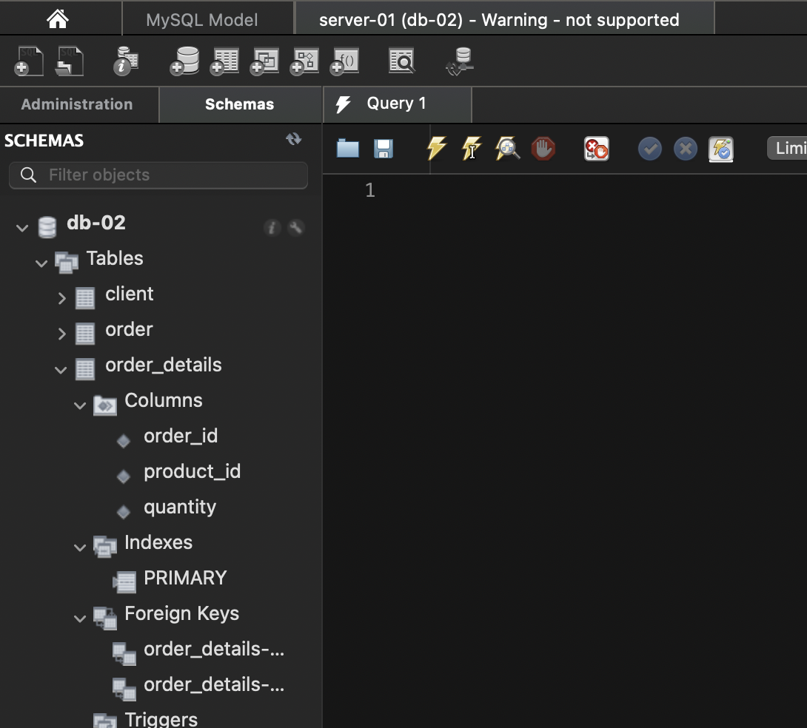

# Реляційні бази даних: Нормалізація та створення ER-діаграм (goit-rdb-hw-02)

Цей репозиторій містить виконання домашнього завдання з проєктування реляційних баз даних. Домашнє завдання включає покрокову нормалізацію таблиць, створення детального опису бази даних та проєктування ER-діаграм.

## 1) Нормалізація таблиць

Початкове завдання на нормалізацію:

### 1-ша нормальна форма

Перша нормальна форма (1НФ) вимагає, щоб усі значення в колонках були атомарними, тобто нероздільними. Крім того, не повинно бути повторюваних груп колонок, а кожний рядок має бути унікальним.

#### Таблиця "Замовлення" (1НФ)

| Номер_замовлення | Назва_товару | Кількість | Адреса_клієнта | Дата_замовлення | Клієнт    |
| ---------------- | :----------- | --------- | :------------- | --------------- | :-------- |
| 101              | Лептоп       | 3         | Хрещатик 1     | 2023-03-15      | Мельник   |
| 101              | Мишка        | 2         | Хрещатик 1     | 2023-03-15      | Мельник   |
| 102              | Принтер      | 1         | Басейна 2      | 2023-03-16      | Шевченко  |
| 103              | Мишка        | 4         | Комп'ютерна 3  | 2023-03-17      | Коваленко |

### 2-га нормальна форма

Друга нормальна форма (2НФ) вимагає, щоб таблиця знаходилась у 1НФ, а також щоб усі неключові атрибути були повністю функціонально залежними від первинного ключа. Тобто, не повинно бути часткових залежностей.

#### Таблиця "Замовлення" (2НФ)

| Номер_замовлення | Адреса_клієнта | Дата_замовлення | Клієнт    |
| ---------------- | :------------- | --------------- | :-------- |
| 101              | Хрещатик 1     | 2023-03-15      | Мельник   |
| 102              | Басейна 2      | 2023-03-16      | Шевченко  |
| 103              | Комп'ютерна 3  | 2023-03-17      | Коваленко |

#### Таблиця "Деталі замовлення" (2НФ)

| Номер_замовлення | Назва_товару | Кількість |
| ---------------- | :----------- | --------- |
| 101              | Лептоп       | 3         |
| 101              | Мишка        | 2         |
| 102              | Принтер      | 1         |
| 103              | Мишка        | 4         |

### 3-тя нормальна форма

Третя нормальна форма (3НФ) вимагає, щоб таблиця знаходилась у 2НФ, а також щоб не було транзитивних залежностей. Транзитивна залежність виникає, коли неключовий атрибут залежить від іншого неключового атрибута.

#### Таблиця "Клієнт" (3НФ)

| id  | Назва     | Адреса        |
| --- | :-------- | :------------ |
| 1   | Мельник   | Хрещатик 1    |
| 2   | Шевченко  | Басейна 2     |
| 3   | Коваленко | Комп'ютерна 3 |

#### Таблиця "Замовлення" (3НФ)

| Номер_замовлення | Дата_замовлення | id_клієнта |
| ---------------- | --------------- | ---------- |
| 101              | 2023-03-15      | 1          |
| 102              | 2023-03-16      | 2          |
| 103              | 2023-03-17      | 3          |

#### Таблиця "Товар" (3НФ)

| id  | Назва   |
| --- | ------- |
| 1   | Лептоп  |
| 2   | Мишка   |
| 3   | Принтер |

#### Таблиця "Деталі замовлення" (3НФ)

| Номер_замовлення | id_товару | Кількість |
| ---------------- | --------- | --------- |
| 101              | 1         | 3         |
| 101              | 2         | 2         |
| 102              | 3         | 1         |
| 103              | 1         | 4         |

## 2) Опис таблиць та полів

### Таблиця client (Клієнт)

| Назва поля | Тип даних    | Опис                             | Приклад    |
| ---------- | ------------ | -------------------------------- | ---------- |
| id         | SERIAL       | Унікальний ідентифікатор клієнта | 1          |
| name       | VARCHAR(100) | Ім'я клієнта                     | Мельник    |
| address    | VARCHAR(255) | Адреса клієнта                   | Хрещатик 1 |

### Таблиця order (Замовлення)

| Назва поля | Тип даних | Опис                                | Приклад    |
| ---------- | --------- | ----------------------------------- | ---------- |
| id         | SERIAL    | Унікальний ідентифікатор замовлення | 1          |
| order_date | DATE      | Дата замовлення                     | 2023-03-15 |
| client_id  | INTEGER   | Ідентифікатор клієнта               | 1          |

### Таблиця product (Товар)

| Назва поля | Тип даних    | Опис                            | Приклад |
| ---------- | ------------ | ------------------------------- | ------- |
| id         | SERIAL       | Унікальний ідентифікатор товару | 1       |
| name       | VARCHAR(100) | Назва товару                    | Лептоп  |

### Таблиця order_details (Деталі замовлення)

| Назва поля | Тип даних | Опис                     | Приклад |
| ---------- | --------- | ------------------------ | ------- |
| order_id   | INTEGER   | Ідентифікатор замовлення | 1       |
| product_id | INTEGER   | Ідентифікатор товару     | 1       |
| quantity   | INTEGER   | Кількість товару         | 1       |

## 3) Діаграма ER (PlantUML)

## 4) Діаграма ER (Workbench)

## 5) Створені таблиці у Workbench (Скриншоти розгорнутої схеми)

Нижче наведено скриншоти розгорнутих схем, що підтверджують створення таблиць та колонок із урахуванням зв'язків у MySQL Workbench:

### Таблиця `client`

### Таблиця `order`

### Таблиця `product`

### Таблиця `order_details`

